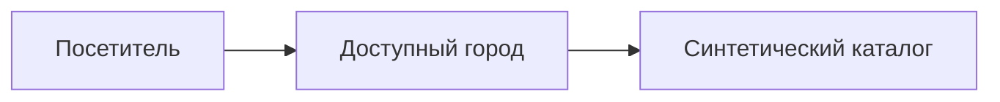
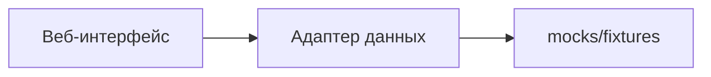
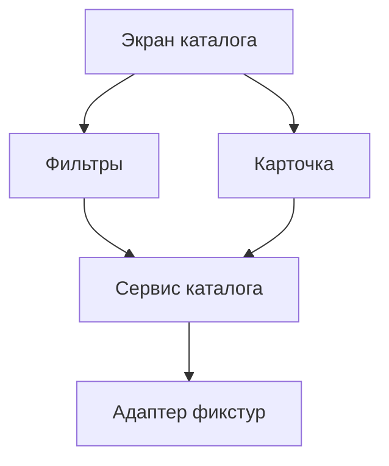
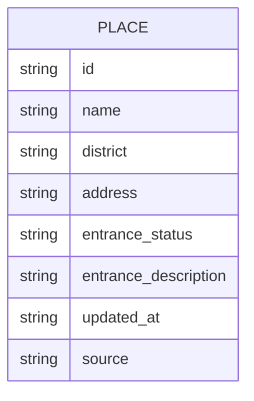

# 03 · Архитектура

## C1 · Контекст

Реальный источник не подтверждён.

## C2 · Контейнеры

Для MVP допустим адаптер, читающий локальные JSON-файлы. Отдельный сервер и база данных не обязательны. Если ИИ реализует HTTP-заглушку, она должна соблюдать `03_contracts/openapi.yaml`.

## C3 · Компоненты

## Модель данных

ER показывает логическую сущность, а не обязательную базу. `source` всегда `demo`. C4 опущена: структура кода ещё не выбрана.

## Решения

- Исходные данные — неизменяемые JSON-файлы; фильтрация и отображение реализуются в продукте.
- Не создавать внешние интеграции и аккаунты для учебного прототипа.
- Механизм запуска ошибки источника должен быть описан в README.
