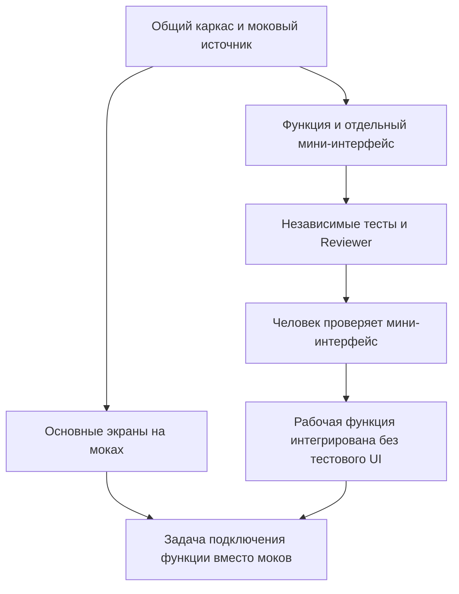

# Лаборатории

[← Брейншторм](brainstorm.md) · [README](../README.md) · [Планирование и агенты →](planning-and-agents.md)

Лаборатория — отдельная ветвь задач для сложной функции с собственным мини-интерфейсом, в котором человек может проверить поведение до подключения функции к основному приложению.

Лаборатория не является вторым пользовательским продуктом и не обязана быть у каждого проекта. Вы сами выбираете функции для неё. Общий каркас и обычные экраны продолжают разрабатываться отдельно; пока функция не подключена, основной сценарий использует согласованные моки.

## Когда лаборатория полезна

Например, отдельно можно проверять распознавание документа, сложный поиск, рекомендации, обработку файла или визуальный редактор. Мини-интерфейс позволяет задать вход, увидеть результат, ошибки и пограничные случаи, не дожидаясь полной готовности основного пользовательского интерфейса.

Обычную небольшую форму не обязательно выносить в лабораторию. Решение зависит от того, нужно ли проверять функцию изолированно и можно ли отделить её файлы и контракт от основной ветки.

## Из чего она состоит

| Часть | Назначение |
| --- | --- |
| Задачи функции (`taskIds`) | Реализуют рабочую функцию и необходимый тестовый интерфейс |
| Тестовый каталог (`uiRoot`) | Только мини-интерфейс и его запуск; `labs/<id>/` |
| Команда preview | Запускает локальный интерфейс из рабочей папки задачи |
| Мок (`mockFixture`) | Данные для основного приложения, пока функция не подключена |
| Задача подключения (`integrationTaskId`) | После готовности функции заменяет моки рабочей реализацией |
| Человеческая приёмка | Подтверждает проверенную версию кода лаборатории |

Рабочий модуль функции находится **вне** `uiRoot`, например `src/features/search.js`. Иначе после исключения тестового UI в основную ветку будет нечего переносить.

## Жизненный цикл на примере



1. Каркас определяет границу функции и моковый источник.
2. Основные экраны и функция лаборатории получают независимые рабочие ветки.
3. Лабораторная задача проходит тесты и ревью.
4. Человек запускает мини-интерфейс, проверяет сценарии и принимает проверенные задачи.
5. Контроллер интегрирует рабочие файлы функции, исключив заявленный тестовый каталог.
6. Отдельная задача подключения меняет основной сценарий с моков на реальную функцию и проверяет приложение.

Человеческое «принято» не означает, что функция уже подключена. До интеграции задачи подключения основной режим остаётся моковым. Ожидающая приёмки лаборатория не должна останавливать другие доступные независимые ветви.

## Как выбрать лаборатории

Перед запуском планирования заполните пожелания: одна функция на строку. Можно оставить поле пустым. ИИ получает пожелания вместе с материалами и кодом возвращённого проекта.

В готовом плане:

1. Откройте «Добавить лабораторию».
2. Укажите название.
3. Выберите задачу, реализующую функцию.
4. Выберите другую задачу её подключения.
5. Выберите существующую мок-фикстуру.
6. Добавьте лабораторию, проверьте граф и сохраните изменения.
7. Заново утвердите план.

Расширенный JSON-редактор позволяет менять больше параметров, чем форма: несколько задач лаборатории, зависимости, файлы и команду запуска. Контроллер проверяет получившийся граф; произвольная правка не означает автоматическое принятие некорректной схемы.

## Пример описания

Это пример структуры, а не готовый план реализации поиска:

```json
{
  "skeletonTaskId": "BASE",
  "laboratories": [
    {
      "id": "SEARCH",
      "title": "Поиск похожих событий",
      "taskIds": ["SEARCH_FEATURE"],
      "uiRoot": "labs/SEARCH/",
      "previewCommand": ["node", "labs/SEARCH/preview.mjs"],
      "mockFixture": "mocks/fixtures/data.json",
      "integrationTaskId": "JOIN_SEARCH"
    }
  ]
}
```

Здесь `BASE`, `SEARCH_FEATURE` и `JOIN_SEARCH` должны существовать в `03_tasks.json`. Задача подключения зависит от всех задач лаборатории. Остальные задачи прямо или транзитивно зависят от общего каркаса.

## Правила графа и файлов

- ID лабораторий уникальны; задачи нельзя одновременно назначить двум лабораториям.
- Общий каркас не назначается задачей лаборатории.
- `uiRoot` имеет точный вид `labs/<id>/`.
- Preview-скрипт перечислен в `allowedPaths` одной из задач лаборатории.
- Должны быть разрешены и рабочие файлы функции за пределами `uiRoot`.
- Мок-фикстура уже существует среди утверждённых материалов.
- Независимые задачи не имеют пересекающихся разрешённых файлов. Для общего файла нужна отдельная задача-владелец или зависимость, сериализующая изменения.
- Файлы `labs/` не могут быть назначены обычной задаче без лаборатории: иначе они попали бы в основной проект при обычной интеграции.

Удаление лаборатории в интерфейсе убирает её тестовые пути из разрешений соответствующих задач. После ручной правки JSON тоже проверьте, что в обычных задачах не осталось тестовых файлов и устаревших указаний создать мини-интерфейс.

## Запуск тестового интерфейса

На этапе разработки откройте блок лабораторий и нажмите «Запустить тестовый интерфейс». После запуска появится ссылка на локальный адрес.

Команда имеет вид двух аргументов:

```json
["node", "labs/SEARCH/preview.mjs"]
```

Поддерживаются `node`, `python`, `python3`; скрипт должен находиться в `uiRoot` и иметь расширение `.mjs`, `.js` или `.py`. Это не shell-строка и не произвольная команда `npm run ...`.

Скрипт получает `PORT`, `HOST=127.0.0.1` и `MAKORA_LABORATORY=<id>`. Он должен открыть локальный порт и показать **реальную функцию лаборатории**, а не выдать заглушку за её результат. Установка зависимостей не выполняется кнопкой preview: окружение и скрипт должны быть готовы.

Контроллер выбирает последнюю подходящую подготовленную рабочую папку среди задач этой лаборатории. В ней должен существовать preview-скрипт. Для многозадачной лаборатории заранее спланируйте его доступность; одной декларации пути в JSON недостаточно.

Если процесс завершился или не открыл порт за время ожидания, возвращается ошибка и путь к логу. Не нужно продолжать по неработающей ссылке. При штатном закрытии сервера Макоры запущенные им preview-процессы завершаются.

## Что проверить человеку

Проверяйте не только наличие страницы:

1. Корректный типичный вход и результат функции.
2. Пустые, неверные и пограничные данные, если они относятся к функции.
3. Понятность ошибок и возможность восстановиться.
4. Соответствие согласованной идее и версии продукта.
5. Отличие реального вычисления функции от мокового поведения основного приложения.

После этого нажмите «Принять проверенные задачи». Если задач несколько, готовые проверенные задачи могут приниматься по мере их завершения. Основной граф и зависимости по-прежнему определяют, когда доступна общая интеграция.

## Почему приёмка может потребоваться повторно

Приёмка привязана к хешу файлов задачи. Если после проверки изменился код, одного прежнего подтверждения недостаточно. После переноса параллельной ветки на новую базу заново проверяются тесты и ревью; при изменившемся хеше повторите и человеческую проверку.

Без приёмки текущего хеша контроллер блокирует интеграцию с `LAB_HUMAN_ACCEPTANCE_REQUIRED`, даже если модель рекомендует выполнить её.

## Что попадает в основное приложение

Контроллер не добавляет файлы из заявленного `uiRoot` в коммит интеграции лабораторной функции. Они остаются в рабочей папке лаборатории для тестирования. В основную ветку переходят рабочие модули за пределами этого каталога.

Это не заменяет проверку production-сборки: рабочие модули не должны импортировать `labs/`, а задача подключения должна проверить отсутствие тестовых экранов и маршрутов в финальном приложении. Правильное использование моков и переключение на функцию реализуются кодом приложения по утверждённому плану; Макора не может универсально заменить любой источник данных без такого кода.

Состояние лаборатории отражает эту последовательность: `developing` → `ready` → `connected`. Пока задача подключения не интегрирована, источник помечается как `mock`; после подключения — `feature`.

## Смотрите также

- [Планирование и агенты](planning-and-agents.md)
- [Все семь этапов](stages.md)
- [Ошибки и восстановление](troubleshooting.md)
