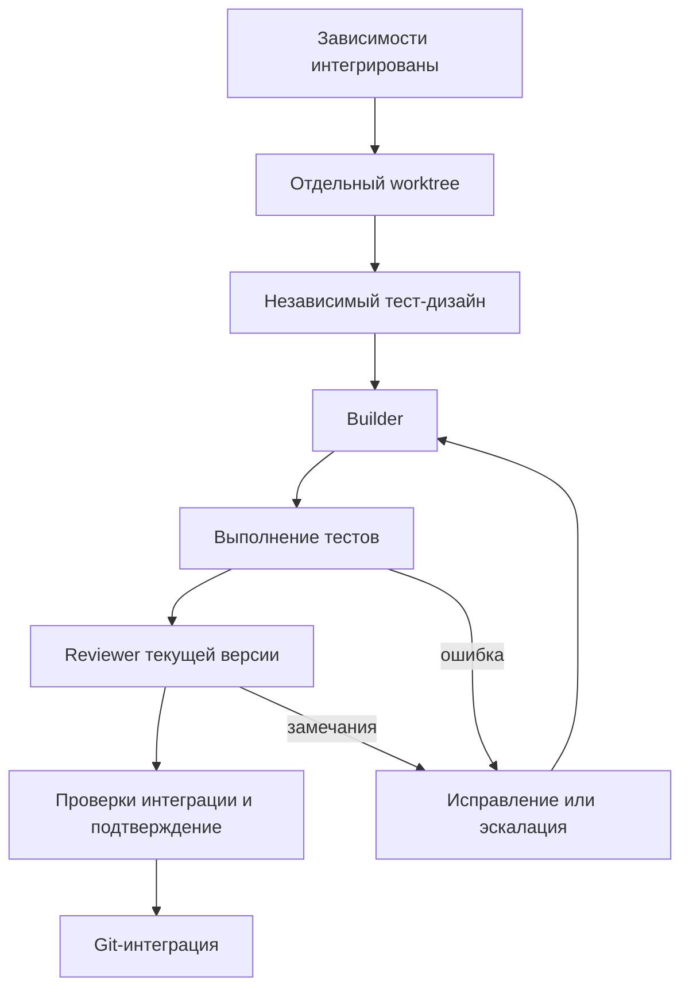

# Планирование и разработка агентами

[← Лаборатории](laboratories.md) · [README](../README.md) · [Файлы и состояние →](artifacts-and-state.md)

Планирование выполняется после возврата проекта внешнего агента. Оно отвечает на вопрос «как развивать этот код», а не создаёт вторую несвязанную концепцию продукта.

## Основание плана

Планировщик получает исходный кейс, согласованные версии и экраны, моки, решения пользователя и путь к подготовленному проекту. Он должен изучить существующий код: уже реализованную функцию не нужно описывать как отсутствующую только потому, что она не упоминалась в кратком тексте.

Результат состоит из архитектуры, OpenAPI, тест-плана, задач и схемы исполнения. Пользователь утверждает их до разработки.

## Задача в графе

| Поле | Смысл |
| --- | --- |
| `id` | Уникальный ID задачи |
| `title`, `goal` | Название и конкретный результат |
| `acceptance` | Проверяемые критерии готовности |
| `dependsOn` | ID задач, которые должны быть интегрированы раньше |
| `contracts` | Связанные контракты |
| `mocks` | Пути к используемым мокам, а не текстовое описание заглушек |
| `allowedPaths` | Точные относительные файлы, которые задача вправе менять |
| `builderPrompt` | Инструкция исполнителю |
| `testPrompt` | Основание для независимого тест-дизайна |
| `reviewerPrompt` | Основание для проверки результата |

Поля списков передаются массивами. В `allowedPaths` нельзя заменить точный файл широким wildcard или путём вне проекта. Контроллер ограничивает очередь 40 задачами.

## Общий каркас

`skeletonTaskId` указывает первую задачу с пустым `dependsOn`. Все остальные задачи должны зависеть от неё прямо или транзитивно.

Каркас может включать базовый запуск приложения, общие типы/контракты, навигацию и границы источников данных. Его точный состав определяется продуктом и уже существующим кодом. Это не требование переписать весь возвращённый проект с нуля.

## Параллельность

Независимые ветви могут исполняться параллельно, если они не меняют одни и те же файлы. Общий файл выделяется владельцу или задачи упорядочиваются зависимостью.

В текущем runtime новый запуск получает `maxParallel: 2`. Есть и отдельные ограничения автопилота по активным агентам и числу действий. Это не обещание одновременно запустить все лаборатории: граф задаёт допустимую параллельность, а runtime и доступные ресурсы ограничивают фактический запуск.

Лаборатория не должна становиться зависимостью всех обычных экранов. Пока она разрабатывается, основные задачи используют моки. Общая задача подключения ждёт готовности соответствующей функции. Устройство ветвей описано в [лабораториях](laboratories.md).

## Редактор плана

На доске доступна визуализация графа и расширенный редактор задач/исполнения в JSON. Через форму добавления лаборатории можно выбрать задачи и мок, не набирая весь JSON вручную.

«Обновить схему» перерисовывает локальный вариант. «Сохранить изменения» отправляет его контроллеру и проверяет зависимости. После сохранения статус снова `review`: нужно заново утвердить план.

Цикл зависимостей, отсутствующий ID, пересечение независимых файлов или несуществующий мок лаборатории являются ошибками схемы. Сохранение не должно молча исключать неверные задачи.

После создания очереди её нельзя незаметно заменить через этот редактор. Для нового графа используйте уточнение/пересоздание плана и новое утверждение. Существующая история запусков остаётся.

## Что происходит на этапе разработки

1. В проект копируются утверждённые материалы и фиксируется однозначная Git-база.
2. Создаётся очередь из утверждённых `03_tasks.json` и `03_execution.json`.
3. При повторном открытии того же графа используется сохранённый запуск.
4. Пользователь или координатор запускает допустимые действия.

Основной маршрут v3 не отправляет утверждённый граф второму планировщику для новой декомпозиции. Старые API планировщика остаются в runtime для совместимости и отдельных сценариев; они не являются обязательным дополнительным этапом доски.

## Роли

| Роль | Работа |
| --- | --- |
| Макора / `preparation` | Подготовительные документы и взаимодействие этапов |
| Test Designer / `test_designer` | Независимый набор проверок по задаче |
| Builder / `builder` | Реализация в выделенной рабочей папке |
| Reviewer / `reviewer` | Проверка текущего кода и оснований готовности |
| Координатор / `mahoraga_orchestrator` | Предлагает допустимый следующий набор действий очереди |
| Специалист / `mahoraga` | Разбирает сложную проблему после ограниченных попыток исправления |

Роль планировщика `mahoraga_planner` и профиль `project_chat` сохраняются в настройках совместимости. Обычный пользовательский чат находится в Desktop и не превращается в общий чат внутри сайта.

## Цикл задачи

Для лаборатории между ревью и интеграцией дополнительно требуется приёмка человеком. Ожидающие проверки лаборатории не должны останавливать доступную независимую работу координатора.

## Основания интеграции

Контроллер проверяет подтверждение действия, независимые тесты, вердикт Reviewer и совпадение хешей кода и набора тестов. Основная папка должна быть чистой и соответствовать ожидаемой базе.

Если другая ветвь уже интегрировалась, устаревшую задачу нужно перенести на новую базу. После переноса результаты тестов/ревью сбрасываются и выполняются заново. Git-конфликт не устраняется простым подтверждением списка файлов: требуется фактически разрешённый конфликт и повторная проверка.

## Автопилот

Автопилот координирует разрешённые операции через runtime. Он не снимает проверки интеграции и не подменяет человеческую приёмку лаборатории. Возможные паузы: требуется решение человека, достигнут лимит действий, исчерпаны попытки исправления, остался конфликт или нет допустимого действия.

Не включайте автопилот ради того, чтобы обойти ошибку подготовки. Сначала согласуйте правильный граф и критерии готовности. Изменения модели роли применяются к последующим сессиям, а не переписывают уже начатый ответ.

## Приёмка продукта

Статус `integrated` относится к задаче и Git-истории. После завершения очереди человек проверяет продукт по согласованным экранам, сценариям и версиям: запуск, переходы, реальные источники, поведение ошибок и отсутствие тестового UI лабораторий.

Успешный текстовый ответ агента, импорт ZIP и зелёные структурные проверки документов — разные доказательства. Ни одно из них само по себе не означает, что продукт уже готов к работе в реальной среде.

## Смотрите также

- [Лаборатории](laboratories.md)
- [Модели и навыки](configuration.md)
- [Файлы и состояние](artifacts-and-state.md)
