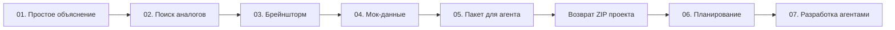

# Как устроен рабочий процесс

[← Установка и первый запуск](getting-started.md) · [README](../README.md) · [Все семь этапов →](stages.md)

Макора связывает обсуждение в Codex, документы на доске и проверяемую разработку. Единица работы — текущий проект со своим кейсом, материалами, настройками моделей и историей. Перезагрузка страницы не создаёт новый проект.

## Маршрут

Порядок влияет на зависимости, а не только на расположение карточек. Моки создаются до планирования агентов. План составляется уже по возвращённому проекту. Разработка получает утверждённую очередь, а не запускает ещё один независимый планировщик.

## Что делает человек

- Передаёт кейс и проверяет, верно ли он понят.
- Решает, какие идеи аналогов полезны, и может продолжить с непроверенными источниками.
- Формулирует собственную идею в Codex и согласовывает версии и экраны.
- Проверяет документы и моки на доске.
- Передаёт пакет внешнему агенту и загружает полученный ZIP.
- Выбирает лаборатории, изменяет задачи и зависимости, утверждает план.
- Проверяет реальные функции лабораторий и принимает результат разработки.

## Что делает ИИ

ИИ создаёт материалы конкретного этапа по его навыкам и входным файлам. Он не должен заменять идею человека готовой концепцией, выдумывать ограничения кейса или объявлять внешние сведения проверенными без источника. В разработке отдельные роли реализуют код, готовят тесты и выполняют ревью.

## Что делает контроллер

Контроллер хранит состояние, запускает нужный чат или агентную сессию, читает готовый результат, проверяет формат и зависимости, сохраняет документы и управляет очередью. Он проверяет цитаты ограничений, источники аналогов, структуру версий/экранов, схемы моков, граф задач и основания интеграции.

Проверка структуры не доказывает полноту смысла. Например, существование описания экрана не доказывает, что экран удобен; проходящие тесты не заменяют осмотр функции человеком.

## Три разных решения о готовности

| Решение | Что оно означает |
| --- | --- |
| ИИ закончил ответ | Получен результат генерации; файлы ещё могут не пройти проверки |
| Контроллер принял документы | Результат можно показать для проверки; этап обычно получает `review` |
| Человек утвердил этап | Материалы становятся основанием следующего этапа; статус `approved` |

В брейншторме есть дополнительная граница: сначала нужно согласовать предложение версий в Codex. Только после этого документы публикуются на доске, где их можно проверить и утвердить для перехода к мокам.

## Исключение для аналогов

На этапе аналогов можно продолжить даже после ошибки проверки источников. Такой результат получает статус `continued`, а не `approved`. Проверки и пометки о недостоверности сохраняются и передаются брейншторму. Следующие материалы не должны ссылаться на гипотезу как на подтверждённый факт.

Нельзя аналогичным образом объявить готовыми непроверенные моки, неподтверждённый брейншторм или неутверждённый план.

## Работа доски

На закрытой доске видны названия, номера и состояния этапов. Содержание открывается по клику. В полноэкранном режиме можно переключаться между этапами; закрытый этап объяснит, что требуется закончить раньше. Просмотр документа не равен его утверждению.

Повторная проверка готового ответа читает существующие файлы и состояние сессии. Пересоздание с уточнениями отправляет новое задание модели. Эти действия различаются по смыслу и расходованию лимитов.

## Если меняется раннее решение

Изменение идеи может потребовать новых моков, пакета и плана. Перегенерация раннего этапа помечает зависимые результаты как требующие обновления. Исправление уже утверждённого файла через механизм изменений проходит через предложение, diff и анализ влияния.

Документы не следует редактировать в `.makora/.../state.json`. Для правок используйте интерфейс, чат с навыком `makora-change` или [API изменений](api.md#изменения-артефактов).

## Номера на доске и ID в API

| Доска | Название | API-ID |
| --- | --- | --- |
| 01 | Простое объяснение | `0` |
| 02 | Поиск аналогов | `2` |
| 03 | Брейншторм | `3` |
| 04 | Мок-данные | `5` |
| 05 | Пакет для агента | `6` |
| 06 | Планирование | `4` |
| 07 | Разработка агентами | `7` |

API-ID сохранены для совместимости. Поэтому `/api/preparation/4/start` запускает **планирование, шестой этап доски**. ID `1` относится к прежнему анализу задания и не запускается в действующем процессе v3.

Полные входы, результаты и критерии перехода приведены в [описании этапов](stages.md).

## Смотрите также

- [Все семь этапов](stages.md)
- [Лаборатории](laboratories.md)
- [Файлы и состояние](artifacts-and-state.md)
